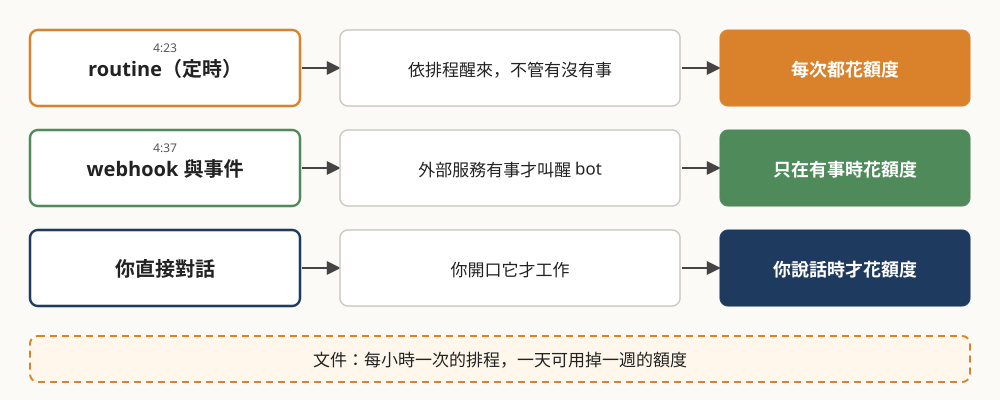
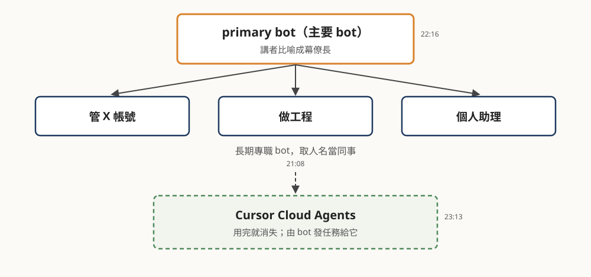
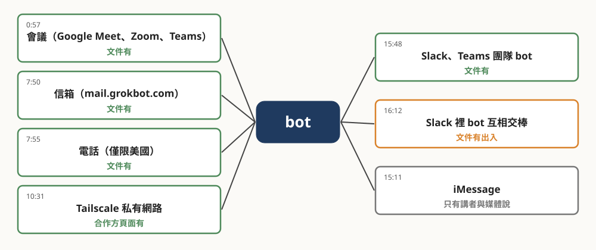
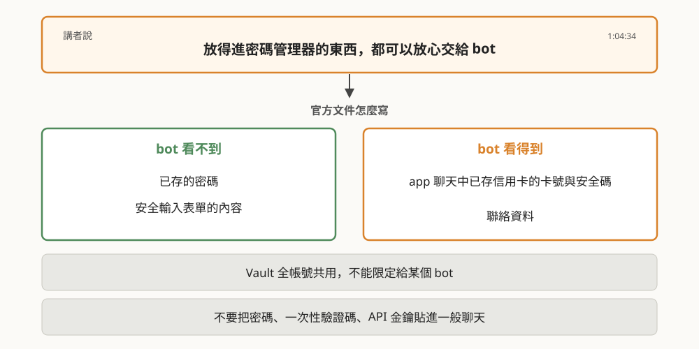

# Grok Bot 團隊直播問答：怎麼用、怎麼省，哪些說法要對文件

> 本導讀的分析與撰稿由 AI 模型完成，不是人類分析，也沒有經過人工逐句校稿，見〈製作說明〉。

*圖說：AI 生成的示意插畫；圖內沒有文字，也不是影片畫面。*

Grok Bot 是 xAI 做的 AI 助理產品：每個 bot 有自己的雲端電腦，能接 Slack、行事曆、信箱，也能排程做事。這支影片是兩位做這個產品的人，在 Grok Bot 1.0 發布那一週的週五晚上開直播，回答觀眾留言（[0:33](https://www.youtube.com/watch?v=doLKqG8TefU&t=33s)）。話題很雜，從省額度、bot 要開幾個、會議與電話，到觀眾拿它做生意、修卡車。**影片的價值在實際用法與「他們自己怎麼想」；功能是否真如所說，要拿官方文件對。**本文兩者都放，講者說的與官方不同之處集中在文末對照表。

## 三十秒版

- 額度大多燒在 routine（定時任務）上。直播給的對策是：到用量頁依 bot 看哪個最耗，合併或刪掉不用的 routine，能用 webhook（外部事件觸發）的就別讓 bot 定時醒來看（[4:00](https://www.youtube.com/watch?v=doLKqG8TefU&t=240s)、[4:23](https://www.youtube.com/watch?v=doLKqG8TefU&t=263s)、[4:37](https://www.youtube.com/watch?v=doLKqG8TefU&t=277s)）。
- bot 不用開很多。兩位講者都說自己開過太多 bot、後來收斂；他們建議一個主要 bot 加幾個常用的就夠，寫程式這類一次性的工作丟給 Cursor Cloud Agents（Cursor 公司的雲端寫程式助手，做完就關掉）（[19:47](https://www.youtube.com/watch?v=doLKqG8TefU&t=1187s)、[20:45](https://www.youtube.com/watch?v=doLKqG8TefU&t=1245s)、[21:32](https://www.youtube.com/watch?v=doLKqG8TefU&t=1292s)、[23:13](https://www.youtube.com/watch?v=doLKqG8TefU&t=1393s)）。
- 他們點名的反模式（最常見的錯誤用法），是把 bot 只當聊天機器人；他們要大家把它當會做事的同事（[31:23](https://www.youtube.com/watch?v=doLKqG8TefU&t=1883s)、[36:01](https://www.youtube.com/watch?v=doLKqG8TefU&t=2161s)）。同時兩人都說，寫給人的話要自己寫（[33:45](https://www.youtube.com/watch?v=doLKqG8TefU&t=2025s)、[34:21](https://www.youtube.com/watch?v=doLKqG8TefU&t=2061s)）。
- 官方文件或合作方頁面能對上的有：會議、信箱、用量頁、routine 耗額度、Tailscale 整合、iPhone 的 Action button。有出入的有範本公開、密碼保險箱（Vault）、在 Slack 讓 bot 互相交棒、電話轉到本人手機，詳見文末對照表。
- 觀眾案例很多，但全是留言自述，沒人查證。

## 這篇怎麼讀

兩位講者在這場直播裡都談自己的產品。Matt Palmer 是頻道主，直播中說自己在 SpaceX 工作（[39:31](https://www.youtube.com/watch?v=doLKqG8TefU&t=2371s)；x.ai 官方頁尾的公司名是 SpaceX Super Intelligence LLC）；x.ai 官方 marketplace 把兩人的 bot 放在「From Grok Bot Team」分類〔一手〕；Lauren Tan 的 GitHub 個人檔案（自填）也寫任職 @xai-org。影片說明欄附了 x.ai/bot 的連結，沒有標示業配。**所以這是產品團隊談自家產品，不是第三方評測。**

字幕是 YouTube 上的英文字幕軌，沒有說話者標記。本文只在對話內容能判斷時寫出人名，例如一方稱另一方「Lauren」，或說「我在新加坡長大」；判斷不了的，就寫「直播中有人說」。

文中標籤：〔講者〕只有講者這麼說；〔一手〕依官方文件或合作方官方頁（含該頁沒有寫這一點的情況）；〔二手〕只有媒體轉述；〔觀眾〕留言自述。

## 額度：省在哪裡

直播一開始就有人問用量。他們教的第一步是看帳：頭像 → Settings → Usage and billing → Grok Bot usage，可以依 bot 篩選，看哪個 bot 吃最多（[4:00](https://www.youtube.com/watch?v=doLKqG8TefU&t=240s)）。官方文件的用量頁確有「By Bot」與「By source」兩種看法〔一手〕。

routine 是讓 bot 定時自己工作的設定，每跑一次就花一次額度。講者說，一天跑一次但做很多事的 routine，約等於你和 bot 聊 15 到 30 分鐘（[14:06](https://www.youtube.com/watch?v=doLKqG8TefU&t=846s)）。

> 重點：文件也提醒，每小時一次的排程，一天就能用掉一週的額度，建議先暫停不需要的 routine〔一手〕。

省的辦法有三個：

1. **合併或刪掉不用的 routine。** 講者說，常見的狀況是六個 bot、十幾二十個 routine，額度就不夠用（[13:49](https://www.youtube.com/watch?v=doLKqG8TefU&t=829s)）。另有人提醒，每五分鐘跑一次的 routine 值得停下來想想（[33:20](https://www.youtube.com/watch?v=doLKqG8TefU&t=2000s)）。
2. **能用 webhook 就用 webhook。** routine 像鬧鐘，到點就叫 bot 起床；webhook 是外部服務（例如 Linear）發生事情時才叫醒它（[4:37](https://www.youtube.com/watch?v=doLKqG8TefU&t=277s)、[4:53](https://www.youtube.com/watch?v=doLKqG8TefU&t=293s)）。文件列出 routine 可由 GitHub、Linear、Sentry、PagerDuty 的事件、信件或 webhook 觸發〔一手〕。
3. **少塞大檔案進對話。** 給 AI 的內容都會進 context（模型一次看得到的範圍），丟一份巨大的表格檔（CSV）進去就是耗額度（[14:32](https://www.youtube.com/watch?v=doLKqG8TefU&t=872s)）。

講者還提到 MCP（讓 AI 連接外部工具的共通規格）有個新的 events 擴充，可以讓 bot 只在事情發生時才醒；他說團隊「在看」，沒說已支援（[5:21](https://www.youtube.com/watch?v=doLKqG8TefU&t=321s)）。這份擴充 MCP 官方已正式通過〔一手〕。

有一項只能當傳聞：講者讀了同事貼文，說本週的 harness（驅動 bot 的底層程式）優化，讓方案用量多約 7%、routine 的執行量最多多 15%（[13:24](https://www.youtube.com/watch?v=doLKqG8TefU&t=804s)）。1.0 發布文與官方文件沒有這組數字，只見於一家媒體轉述那則貼文〔二手〕，詳見文末對照。

## bot 要開幾個

有人問，講者自己開幾個。Matt 說自己經歷過一段「開太多 bot」的階段：Grok Bot 一出來就開了一大堆，多到管不過來（[19:47](https://www.youtube.com/watch?v=doLKqG8TefU&t=1187s)）。他後來把 bot 當工具：**經常遇到的問題才值得一個專職 bot**，例如寫文案的；偶爾才有的事，像在二手平台賣東西，就開一個用完即丟的（[20:08](https://www.youtube.com/watch?v=doLKqG8TefU&t=1208s)、[20:22](https://www.youtube.com/watch?v=doLKqG8TefU&t=1222s)）。

Lauren 的路徑相近。她一開始想開 50 個，後來發現管理它們本身就很累，於是合併（[20:48](https://www.youtube.com/watch?v=doLKqG8TefU&t=1248s)、[21:01](https://www.youtube.com/watch?v=doLKqG8TefU&t=1261s)）。她把 bot 當同事看待，每個都取人名，現在有管她 X 帳號的、做工程的、當個人助理的（[21:08](https://www.youtube.com/watch?v=doLKqG8TefU&t=1268s)、[21:15](https://www.youtube.com/watch?v=doLKqG8TefU&t=1275s)）。寫程式的專案則丟給 Cursor 專案或 Cursor Cloud Agents：它們用完就消失，不用一直留在 bot 清單裡（[21:32](https://www.youtube.com/watch?v=doLKqG8TefU&t=1292s)、[21:41](https://www.youtube.com/watch?v=doLKqG8TefU&t=1301s)）。

幾個相關的產品設計：

- **primary bot（主要 bot）。** 可以指定一個，講者把它比喻成幕僚長（chief of staff）（[22:16](https://www.youtube.com/watch?v=doLKqG8TefU&t=1336s)、[22:23](https://www.youtube.com/watch?v=doLKqG8TefU&t=1343s)）。文件寫的是「主要聯絡人，會自己找你，也協調其他 bot」〔一手〕。
- **Cursor Cloud Agents。** Lauren 把它說成 bot 的小幫手：它有自己的電腦，做完事就走；bot 自己寫程式會被卡住，叫幫手去做，bot 就能同時做別的事（[23:13](https://www.youtube.com/watch?v=doLKqG8TefU&t=1393s)、[23:35](https://www.youtube.com/watch?v=doLKqG8TefU&t=1415s)）。Matt 補充兩個好處：寫程式用的環境可以裝一堆技能與連線，不必塞進 bot 自己的 context；也能搭配不同模型（[24:12](https://www.youtube.com/watch?v=doLKqG8TefU&t=1452s)、[24:37](https://www.youtube.com/watch?v=doLKqG8TefU&t=1477s)）。他自己剪影片就走這條路，Grok Bot 發任務給 Cursor Cloud Agents，後面接自己寫的工具（[25:08](https://www.youtube.com/watch?v=doLKqG8TefU&t=1508s)、[25:16](https://www.youtube.com/watch?v=doLKqG8TefU&t=1516s)）。
- **接新工具。** 只要那個服務開放程式介面（MCP 或 API），就能做成 bot 的自訂工具；Lauren 的 TinkerBot 範本就是拿來做這件事（[22:40](https://www.youtube.com/watch?v=doLKqG8TefU&t=1360s)）。

## 把 bot 接進工作：會議、Slack、電話

**會議。** Lauren 被問到最喜歡的功能時，先提購物，接著提到會議（[0:44](https://www.youtube.com/watch?v=doLKqG8TefU&t=44s)、[0:55](https://www.youtube.com/watch?v=doLKqG8TefU&t=55s)）：bot 可以代你進 Google Meet 或 Zoom，做會議紀錄；在會議聊天室點它的名字，它會去做事並回在聊天室（[0:57](https://www.youtube.com/watch?v=doLKqG8TefU&t=57s)、[1:09](https://www.youtube.com/watch?v=doLKqG8TefU&t=69s)）。官方文件吻合，還多列 Microsoft Teams；這個功能有方案限制，以官方頁為準〔一手〕。另一位講者接著說，會議中它能動用你接上的任何 connector（連線外部服務的接口），例如去 Notion 找資料（[1:31](https://www.youtube.com/watch?v=doLKqG8TefU&t=91s)、[1:39](https://www.youtube.com/watch?v=doLKqG8TefU&t=99s)）。

**Slack 與團隊 bot。** 講者說，在 Slack 開一條討論串叫 bot 去修 bug，大家就能一起看、一起接著聊，bot 像隊友（[16:49](https://www.youtube.com/watch?v=doLKqG8TefU&t=1009s)、[17:05](https://www.youtube.com/watch?v=doLKqG8TefU&t=1025s)）。團隊 bot 需要 Team 或 Enterprise 方案，且團隊至少有另一個人；可在 Grok Bot、Slack、Microsoft Teams 使用〔一手〕。講者也說，在 Slack 可以同時 @ 多個 bot，讓它們互相交棒（[16:12](https://www.youtube.com/watch?v=doLKqG8TefU&t=972s)、[16:21](https://www.youtube.com/watch?v=doLKqG8TefU&t=981s)），這點與文件有出入，見文末對照。

**信箱與電話。** 對 bot 說「幫自己要一個信箱」，就會拿到 mail.grokbot.com 的地址（[7:50](https://www.youtube.com/watch?v=doLKqG8TefU&t=470s)、[7:53](https://www.youtube.com/watch?v=doLKqG8TefU&t=473s)）；文件寫每個帳號一個，要按核准才建立〔一手〕。電話功能則是講者說「一兩週前才上線」（[7:55](https://www.youtube.com/watch?v=doLKqG8TefU&t=475s)），有媒體稱 11 月 4 日宣布〔二手〕；用法是請 bot 打給牙醫改時間（[8:11](https://www.youtube.com/watch?v=doLKqG8TefU&t=491s)、[8:17](https://www.youtube.com/watch?v=doLKqG8TefU&t=497s)），或打給監理站、保險公司排隊（[8:23](https://www.youtube.com/watch?v=doLKqG8TefU&t=503s)、[8:32](https://www.youtube.com/watch?v=doLKqG8TefU&t=512s)）。通話時看得到即時逐字稿，可以自己接手（[8:38](https://www.youtube.com/watch?v=doLKqG8TefU&t=518s)、[8:43](https://www.youtube.com/watch?v=doLKqG8TefU&t=523s)），文件對這兩點都有記載〔一手〕。限制方面，講者說國際電話之後才會有，部分美國州因錄音法規暫時不行（[54:37](https://www.youtube.com/watch?v=doLKqG8TefU&t=3277s)、[54:44](https://www.youtube.com/watch?v=doLKqG8TefU&t=3284s)、[58:44](https://www.youtube.com/watch?v=doLKqG8TefU&t=3524s)、[58:47](https://www.youtube.com/watch?v=doLKqG8TefU&t=3527s)）。文件寫電話功能僅限美國〔一手〕；州別的說法見文末對照。

**iMessage。** 講者說本週剛支援，可傳訊息、讀部分簡訊，目前只有 Apple（[15:11](https://www.youtube.com/watch?v=doLKqG8TefU&t=911s)、[15:15](https://www.youtube.com/watch?v=doLKqG8TefU&t=915s)、[52:36](https://www.youtube.com/watch?v=doLKqG8TefU&t=3156s)）。這項見文末對照。

**範本與 iPhone 快捷鍵。** 想讓朋友試用你的 bot，Matt 的做法是：右側設定裡點分享圖示，把 bot 變成範本，傳連結給對方，一鍵安裝（[6:10](https://www.youtube.com/watch?v=doLKqG8TefU&t=370s)、[6:12](https://www.youtube.com/watch?v=doLKqG8TefU&t=372s)、[6:25](https://www.youtube.com/watch?v=doLKqG8TefU&t=385s)）。Lauren 接著說，她做的 Dr. Eggbot、TinkerBot 都以範本公開，別人可以站在她的做法上改（[6:47](https://www.youtube.com/watch?v=doLKqG8TefU&t=407s)）。另一則是觀眾提醒：在 iPhone 設定裡把側邊的 Action button 指給 Grok Bot，按住就能直接開口跟 bot 通話（[1:05:34](https://www.youtube.com/watch?v=doLKqG8TefU&t=3934s)、[1:06:17](https://www.youtube.com/watch?v=doLKqG8TefU&t=3977s)）；官方 Mobile 文件有這項設定〔一手〕。

**家用與區網。** 一則轉述：有人用 Tailscale 整合，在家中的 Plex 媒體伺服器上，每晚替孩子排睡前歌單（[10:31](https://www.youtube.com/watch?v=doLKqG8TefU&t=631s)、[10:52](https://www.youtube.com/watch?v=doLKqG8TefU&t=652s)）。Tailscale 官方部落格確認 Grok Bot 可連到 tailnet（Tailscale 的私有網路）上的私有 MCP server〔一手〕。一位講者的通則是：只要裝置能接上區網，就叫 bot 自己去摸索（[55:04](https://www.youtube.com/watch?v=doLKqG8TefU&t=3304s)、[55:19](https://www.youtube.com/watch?v=doLKqG8TefU&t=3319s)、[55:37](https://www.youtube.com/watch?v=doLKqG8TefU&t=3337s)）；他還說自己想做一個專案：把熱感收據印表機接上區網，讓 bot 每次送出程式碼修改就印一張（還沒做）（[55:31](https://www.youtube.com/watch?v=doLKqG8TefU&t=3331s)、[55:46](https://www.youtube.com/watch?v=doLKqG8TefU&t=3346s)）；觀眾則問能不能控制 CNC（電腦控制的切削）機台（[54:56](https://www.youtube.com/watch?v=doLKqG8TefU&t=3296s)）。Lauren 舉她的 Elgato 補光燈為例：電腦偵測到鏡頭啟動，就用腳本開燈，bot 自己在 Wi-Fi 上找到那些裝置並呼叫它們的程式介面（API）（[55:59](https://www.youtube.com/watch?v=doLKqG8TefU&t=3359s)、[56:15](https://www.youtube.com/watch?v=doLKqG8TefU&t=3375s)、[59:53](https://www.youtube.com/watch?v=doLKqG8TefU&t=3593s)）。

*圖說：各項功能的依據；「文件有」指 docs.x.ai 對應頁面有寫。*

## 他們點名的反模式與主張

**別只當聊天機器人。** 一位講者說，聊天機器人是大語言模型的第一版，只有文字；Grok Bot 是 AI 隊友，要接工具、排 routine、放進 Slack 與會議（[36:01](https://www.youtube.com/watch?v=doLKqG8TefU&t=2161s)、[36:12](https://www.youtube.com/watch?v=doLKqG8TefU&t=2172s)）。講者描述的「野心」包含：叫 bot 訂午餐、冰箱快沒了就補貨（[32:21](https://www.youtube.com/watch?v=doLKqG8TefU&t=1941s)、[32:31](https://www.youtube.com/watch?v=doLKqG8TefU&t=1951s)），或是更正經的，同步更新 Notion 文件、Slack 通知與程式碼，再派 Cursor Cloud Agent 去改（[29:53](https://www.youtube.com/watch?v=doLKqG8TefU&t=1793s)、[30:22](https://www.youtube.com/watch?v=doLKqG8TefU&t=1822s)）。

**自己要說的話自己寫。** Matt 說他不喜歡把溝通外包給 AI；拿 bot 的輸出直接發推，頂多是起點，「那不是我」，他把這種用法叫「slop in, slop out」，意思是 AI 爛稿進、AI 爛稿出（[33:45](https://www.youtube.com/watch?v=doLKqG8TefU&t=2025s)、[34:10](https://www.youtube.com/watch?v=doLKqG8TefU&t=2050s)）。Lauren 附和：寫作本身就是思考；用語音跟 bot 講話，有時候講到自己都不知道在講什麼，動手打字才逼得出想法（[34:21](https://www.youtube.com/watch?v=doLKqG8TefU&t=2061s)、[34:31](https://www.youtube.com/watch?v=doLKqG8TefU&t=2071s)）。所以她請 bot 找資料，但自己寫（[35:05](https://www.youtube.com/watch?v=doLKqG8TefU&t=2105s)、[35:10](https://www.youtube.com/watch?v=doLKqG8TefU&t=2110s)）。

## 觀眾與朋友怎麼用

這一段占了影片相當篇幅，大多是觀眾留言。下表挑具代表性的；**全部是自述，沒有查證。**

| 用途 | 做法（自述） | 時間 |
|---|---|---|
| 咖啡店經營〔講者轉述朋友〕 | 接店裡收銀系統（POS）的資料介面，問「上季什麼賣得好、什麼該下架」；也用在排班與工時 | [39:53](https://www.youtube.com/watch?v=doLKqG8TefU&t=2393s)、[40:11](https://www.youtube.com/watch?v=doLKqG8TefU&t=2411s) |
| 高中足球選手招募〔觀眾〕 | 在 X 上找球員、聯絡，自稱三天內累積超過 3,000 位潛在人選 | [48:09](https://www.youtube.com/watch?v=doLKqG8TefU&t=2889s) |
| 名片整理〔觀眾〕 | 展場收 20 到 30 張名片，鋪桌上拍照，請 bot 產出能匯入客戶管理系統 Salesforce 的試算表 | [51:00](https://www.youtube.com/watch?v=doLKqG8TefU&t=3060s) |
| 醫療帳單與福利說明〔觀眾〕 | 拿保險公司寄的福利說明書（EOB）對醫療帳單；講者補一句：選方案這種難決定，最好也找人討論 | [47:07](https://www.youtube.com/watch?v=doLKqG8TefU&t=2827s)、[47:55](https://www.youtube.com/watch?v=doLKqG8TefU&t=2875s) |
| 找大學獎學金〔觀眾〕 | 開一個 routine，替女兒持續搜尋 | [51:29](https://www.youtube.com/watch?v=doLKqG8TefU&t=3089s) |
| 找婚禮攝影師〔觀眾〕 | 給 bot 喜歡的風格連結，每天送一份符合風格的名單 | [58:00](https://www.youtube.com/watch?v=doLKqG8TefU&t=3480s)、[58:04](https://www.youtube.com/watch?v=doLKqG8TefU&t=3484s) |
| 銷售名單〔觀眾〕 | 從客戶管理系統 HubSpot 找最有意願的潛在客戶、寫開發信、整理成撥號清單 | [56:47](https://www.youtube.com/watch?v=doLKqG8TefU&t=3407s) |
| 卡車維修〔觀眾〕 | 自製 Master Mechanic bot，依症狀教你修，並找零件；留言者說車因此能穩定發動 | [1:09:26](https://www.youtube.com/watch?v=doLKqG8TefU&t=4166s) |

講者自己的用法：Lauren 說受邀上 podcast 前，會叫 bot 查最近的話題（[43:35](https://www.youtube.com/watch?v=doLKqG8TefU&t=2615s)）；講者也說自己會把紙本文件拍照丟給 bot 處理（[51:23](https://www.youtube.com/watch?v=doLKqG8TefU&t=3083s)），並用 bot 盯訂位的取消名額，一收到通知就臨時卡進去（[52:07](https://www.youtube.com/watch?v=doLKqG8TefU&t=3127s)）。他們的朋友、在 X 上播出的節目 MTS 則用 bot 查來賓近況，做成流程稿放進 Google Doc（[44:08](https://www.youtube.com/watch?v=doLKqG8TefU&t=2648s)、[44:49](https://www.youtube.com/watch?v=doLKqG8TefU&t=2689s)）。涉及法律的，他們提醒仍要找律師（[46:14](https://www.youtube.com/watch?v=doLKqG8TefU&t=2774s)）。

## 給想學工程的人

有人問從零開始怎麼成為工程師。一位講者建議用 bot 當家教，例如講者提到量化交易公司 Jane Street 公開的一套「蘇格拉底式」教學 skill（可以裝進 bot 的指令包），叫它用提問的方式教你什麼是編譯器；再把同一個專案重做多遍，每次都學到新東西（[1:11:05](https://www.youtube.com/watch?v=doLKqG8TefU&t=4265s)、[1:11:34](https://www.youtube.com/watch?v=doLKqG8TefU&t=4294s)、[1:11:56](https://www.youtube.com/watch?v=doLKqG8TefU&t=4316s)）。另一位講者回應：**工程不只是寫程式，重點是思考與解題**；偷懶、照單全收 AI 產出的程式，就沒做到「想清楚問題與解法」，所以要有意識地用（[1:12:10](https://www.youtube.com/watch?v=doLKqG8TefU&t=4330s)、[1:13:09](https://www.youtube.com/watch?v=doLKqG8TefU&t=4389s)、[1:13:29](https://www.youtube.com/watch?v=doLKqG8TefU&t=4409s)）。

## 信任：密碼、備份與外部帳號

被問到「什麼可以交給 bot」，Matt 說：Grok Bot 提供安全的輸入管道，bot 永遠看不到密碼；所以放得進密碼管理器的東西，都可以放心交給它（[1:04:26](https://www.youtube.com/watch?v=doLKqG8TefU&t=3866s)、[1:04:34](https://www.youtube.com/watch?v=doLKqG8TefU&t=3874s)）。他另一個提醒是，**絕不要把敏感資訊貼進聊天框**（[1:04:57](https://www.youtube.com/watch?v=doLKqG8TefU&t=3897s)）。官方文件同樣寫 bot 看不到儲存的密碼，也寫不要把密碼、一次性驗證碼或 API 金鑰貼在一般聊天裡〔一手〕。Vault（Grok Bot 存放密碼與信用卡資料的保險箱）的範圍和他的說法有出入，見文末對照。

*圖說：講者的說法與官方 Vault 文件的對照。*

**備份。** 有人問 bot 的電腦怎麼備份。直播中有人建議：用完即丟的東西留在 bot 的電腦；要保存的，備份到 GitHub、Google Drive、Dropbox（[1:03:41](https://www.youtube.com/watch?v=doLKqG8TefU&t=3821s)、[1:03:46](https://www.youtube.com/watch?v=doLKqG8TefU&t=3826s)）。另有人建議可以用雲端檔案儲存，如 Cloudflare R2（[1:03:58](https://www.youtube.com/watch?v=doLKqG8TefU&t=3838s)）。同一位講者也說，電腦會自動更新，可能不會全部保留（[1:03:33](https://www.youtube.com/watch?v=doLKqG8TefU&t=3813s)）；這點與文件的說法略有不同，見文末對照。

**發訊息前先問你。** 有人問：用 bot 發 X 的私訊或貼文，會不會被停權？講者答不會，因為整合每次發訊息前都會請你核准，符合服務條款；腳本或可疑做法則會被封（[49:40](https://www.youtube.com/watch?v=doLKqG8TefU&t=2980s)、[49:45](https://www.youtube.com/watch?v=doLKqG8TefU&t=2985s)、[49:55](https://www.youtube.com/watch?v=doLKqG8TefU&t=2995s)）。這一條在官方文件找不到對應的明文。

## 講者說的與官方文件

| 講者怎麼說 | 官方文件寫的 |
|---|---|
| 範本的公開副本不含任何私人資訊（[6:17](https://www.youtube.com/watch?v=doLKqG8TefU&t=377s)） | 收件人拿不到你的電腦、登入與對話紀錄，但公開連結會露出 bot 的身分、描述、skills 和 routines；分享前要先移除 API 金鑰、內部網址、客戶資料〔一手〕 |
| 放得進密碼管理器的東西，都可以放心交給 bot（他接著補了但書：像身分證號這類，可能連密碼管理器都不該放）（[1:04:34](https://www.youtube.com/watch?v=doLKqG8TefU&t=3874s)） | bot 看不到密碼，但在 app 聊天中看得到已存信用卡的卡號與安全碼；Vault 全帳號共用〔一手〕 |
| 在 Slack 同時 @ 多個 bot 可交棒（[16:12](https://www.youtube.com/watch?v=doLKqG8TefU&t=972s)） | 個人 bot 在 Slack 討論串不能傳訊給其他 bot；要先分享成團隊 bot〔一手〕 |
| 通話可轉到你的手機號碼（[8:26](https://www.youtube.com/watch?v=doLKqG8TefU&t=506s)） | 文件寫「接手（Take over）」，沒寫轉到個人號碼〔一手〕 |
| 部分州因錄音法暫不支援（[58:44](https://www.youtube.com/watch?v=doLKqG8TefU&t=3524s)） | 只寫僅限美國；沒有州別說明〔一手〕 |
| 本週的優化讓用量多約 7%、routine 的執行量最多多 15%（[13:24](https://www.youtube.com/watch?v=doLKqG8TefU&t=804s)） | 1.0 發布文與官方文件沒有這組數字；僅一家媒體轉述〔二手〕 |
| iMessage 本週支援（[15:11](https://www.youtube.com/watch?v=doLKqG8TefU&t=911s)） | 文件未列；有媒體稱是 Mac app 功能〔二手〕 |
| 電腦更新時可能不會全部保留（[1:03:33](https://www.youtube.com/watch?v=doLKqG8TefU&t=3813s)） | 一般更新與復原後檔案會保留；暫存目錄與手動安裝的程式會掉〔一手〕 |
| 會議中它能動用你接上的任何 connector（[1:31](https://www.youtube.com/watch?v=doLKqG8TefU&t=91s)） | 文件寫它在會議聊天室回答問題，沒有這句說明〔一手〕 |
| 連上 Tailscale 後，bot 能控制區網上的裝置（[1:01:45](https://www.youtube.com/watch?v=doLKqG8TefU&t=3705s)） | Tailscale 官方部落格只談 Grok Bot 連到 tailnet 上的私有 MCP server，並受該網路的權限規則管控〔一手〕 |
| 發 X 私訊與貼文一律先核准〔講者〕（[49:45](https://www.youtube.com/watch?v=doLKqG8TefU&t=2985s)） | 官方文件沒有這條明文 |

## 讀這場直播的限制

這是產品團隊自家的直播，沒有批評者在場，觀眾問題也多半友善，所以**聽到的偏向「能做什麼」，少談失敗與成本**。額度是直播中最常被提起的痛處，直播中說團隊聽到了，但念出的改善數字，1.0 發布文與官方文件都沒有（見〈額度：省在哪裡〉）。功能與方案限制很新，文件在直播前後才大改過，本文依據的是 2026-11-21 的文件版本。最後約十分鐘是閒聊，從海南雞飯、新加坡的擁車證，到 GTA 6，本文都沒放。**要把敏感資料與重要檔案交給 bot 之前，先讀官方文件對那項功能的限制**，不要只憑直播的描述。

## 製作說明：這篇導讀由 AI 模型完成

本導讀的分析、撰稿、翻譯、查證與插圖皆由 AI 模型完成，不是人類分析，也沒有經過人工逐句校稿。分工如下：逐句翻譯用 Google 的 Gemini 3.8 Flash（第 1 到 150 句改由 OpenAI Codex 的 gpt-6-luna 備援初譯），逐章修詞用 Claude Sonnet，統一審查、事實查證與獨立審稿用 Claude Opus，撰稿、依審稿意見修稿與統籌為 Claude Sonnet，最後再由一位 Claude Opus 依總編輯準則潤稿並標示重點；封面插畫由 Codex 的 imagegen 生成，圖解由 Claude Sonnet 撰寫 SVG 程式繪製。字幕是 YouTube 上的英文字幕軌，未對照原音逐句校對；專名可能有誤聽，中文依上下文還原。查證原則：重要說法須有官方或合作方的一手頁面才標〔一手〕，只有單方說法者降級標示。另有[全文譯本](translation-zh.html)，以及可邊看影片邊看中英字幕的[字幕播放器](player.html)。

## 來源清單

- Matt Palmer 頻道：〈Grok Bot Q&A with Lauren Tan〉，2026-11-20 上傳（X 直播日 2026-11-13）。https://www.youtube.com/watch?v=doLKqG8TefU
- x.ai：Introducing Grok Bot 1.0（頁面標 2026-11-11，2026-11-21 讀取）。https://x.ai/news/grok-bot-1-0
- Grok Bot 文件（docs.x.ai，2026-11-21 讀取；各頁 dateModified 為 2026-11-13 至 11-19）：
  [Overview](https://docs.x.ai/grok-bot/overview)、[Meetings](https://docs.x.ai/grok-bot/meetings)、[Settings and notifications](https://docs.x.ai/grok-bot/settings-and-notifications)、[Skills, routines and automations](https://docs.x.ai/grok-bot/skills-routines-and-automations)、[Bots](https://docs.x.ai/grok-bot/bots)、[Chat and collaboration](https://docs.x.ai/grok-bot/chat-and-collaboration)、[Team bots](https://docs.x.ai/grok-bot/team-bots)、[Vault](https://docs.x.ai/grok-bot/vault)、[Approvals, security and privacy](https://docs.x.ai/grok-bot/approvals-security-and-privacy)、[Computer and apps](https://docs.x.ai/grok-bot/computer-and-apps)、[Files and results](https://docs.x.ai/grok-bot/files-and-results)、[Mobile](https://docs.x.ai/grok-bot/mobile)
- Tailscale：Grok Bot has a Tailscale integration（2026-11-09）。https://tailscale.com/blog/oauth-apps-ga
- Model Context Protocol：SEP-3415 Events extension（2026-10-05 建立，狀態 Final）。https://modelcontextprotocol.io/seps/3415-events-extension
- x.ai：Grok Bot marketplace（無日期，2026-11-21 讀取）。https://x.ai/bot/marketplace
- poteto 的 GitHub 個人檔案（自填資料，2026-11-21 讀取）。https://github.com/poteto
- Teslanorth：電話功能上線（2026-11-04，二手）。https://teslanorth.com/2026/11/04/grok-bot-phone-calls-live/
- Teslanorth：效率改善與 7%／15% 轉述（2026-11-14，二手）。https://teslanorth.com/2026/11/14/grok-bot-efficiency-more-usage/
- iPhone in Canada：Mac app 連接 Messages、Mail（2026-11-12，二手）。https://www.iphoneincanada.ca/2026/11/12/grok-bot-mac-messages-mail-apps/
- 前案導讀（同一產品的其他影片）：[把 bot 當新同事（YC Lightcone）](https://lushinshang.github.io/grok-bot-lightcone/)、[把糾正寫成規則（Lauren Tan 演講）](https://lushinshang.github.io/lauren-tan-code-slop/)
